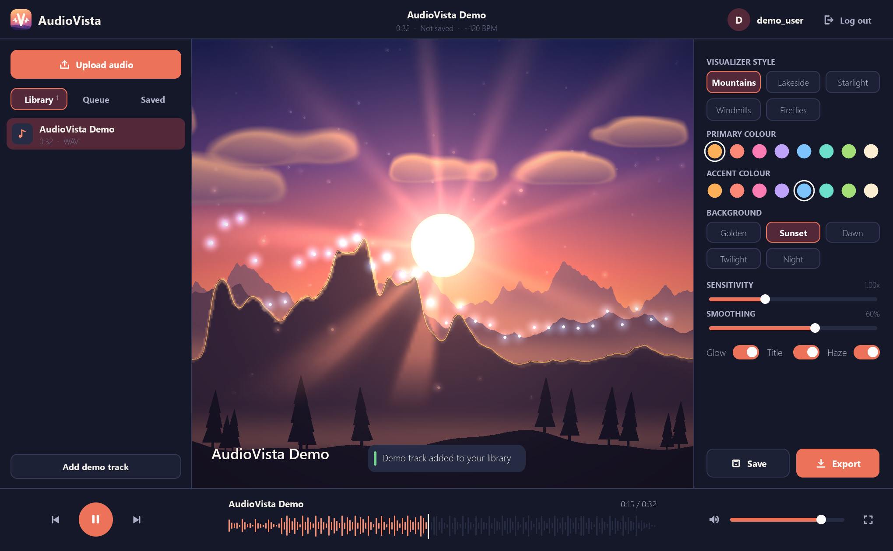

<p align="center"></p>

# AudioVista

**An interactive audio visualization application** — CSI 3370 group project.

AudioVista turns music into synchronized visuals. Upload an MP3, WAV or FLAC
file, pick a visualizer style, colours and background, preview it live while the
song plays, save it to your library and export it as an MP4 video for social
media or YouTube. No video-editing skills required.

The look is meant to feel nostalgic in a calm, dreamy way: soft sunset skies,
layered hills fading into haze, light rays, still lakes and fireflies, all
moving with the music.

Team: Daniel Kraemer · Neb Horton · Theodore Kosarek · Alec Kubs



## Features

| Requirement (Phase 1–3) | Where it lives |
| --- | --- |
| Create account / log in (hashed passwords, lockout after 5 failed attempts) | `AccountController`, `Account`, `Database` |
| Upload audio (MP3, WAV, FLAC, 200 MB limit, drag & drop supported) | `UploadController`, `AudioFile` |
| Readable soundwave: the real waveform drifts across the sky in the Lakeside style (played part bright, upcoming part faint) and is mirrored in the lake, plus a waveform overview on the seek bar | `LakesideRenderer`, `AudioAnalyzer.envelope_buckets` |
| Visuals that react to volume, beat and frequency (FFT) | `AudioAnalyzer`, `visuals/renderers.py` |
| Five living-landscape styles with lots of moving parts: **Mountains** (the front range is the spectrum, with falling peak stars), **Lakeside** (waveform ribbon + rippling reflection, rings on beats), **Starlight** (radial spectrum around the moon, orbiting lights, aurora, shooting stars), **Windmills** (sails driven by bass/mid/treble, the sun crosses the sky over the song), **Fireflies** (grass height follows the spectrum, fireflies wake with the treble) | `visuals/renderers.py`, `visuals/scenery.py` |
| Settings: primary/accent colour, time of day (Golden hour, Sunset, Dawn, Twilight, Night), sensitivity, smoothing, glow, title, haze (god rays, fog, floating motes, soft vignette) | `VisualSettings`, studio right panel |
| Play / pause, seek, volume, previous / next | `AudioPlayer`, studio transport bar |
| Sound queue ("up next") with auto-advance | `PlaybackQueue`, studio *Queue* tab |
| Save result to *My Library*, reopen and delete later | `ResultController`, studio *Saved* tab |
| Export result as MP4 (480p, 720p, 1080p, square, vertical; 30/60 fps) | `ExportController`, `ExportFile` |
| Sharp on high-DPI screens (125–200% scaling), anti-aliased UI, own taskbar icon | `ui/theme.py`, `ui/winshell.py` |

## Getting started (Windows)

Requires **Python 3.10+**.

```bash
python -m pip install -r requirements.txt
```

```bash
python main.py
```

Or double-click `run.bat`. ffmpeg is bundled through the `imageio-ffmpeg`
package, so nothing else needs installing.

First run: create an account, then press **Upload audio** (or drag a file onto
the window). Don't have a song handy? Press **Try the demo track** — AudioVista
synthesises a short royalty-free loop.

### Keyboard shortcuts

| Key | Action |
| --- | --- |
| Space | Play / pause |
| ← / → | Seek 5 seconds |
| 1 – 5 | Switch visualizer style |
| F / Esc | Full view on / off |
| N | Next track in queue |
| Ctrl+O / Ctrl+S / Ctrl+E | Upload / Save / Export |

## Running the tests

```bash
python -m pytest
```

The suite (71 tests) covers the classes chosen for Phase 4 — `AccountController`
and `AudioAnalyzer` — with normal and incorrect inputs, plus the upload, save and
export use cases, `VisualSettings`, `PlaybackQueue`, every renderer and the player
clock. Tests use a temporary data folder and never touch your real library.

To regenerate the screenshots in `docs/screenshots/` (drives the real UI with no
visible window):

```bash
python tools/take_screenshots.py
```

## Architecture

The code follows the Phase 3 design class diagram and sequence diagrams.

```
AudioVistaUI (ui/app.py)
 ├─ AccountController ── Account ── Database (SQLite)
 ├─ UploadController ─── AudioFile ── decoder (ffmpeg / wave) ── AudioAnalyzer (FFT)
 ├─ VisualizerController ─ Visualization ── VisualSettings
 │                          └─ VisualizerEngine ("Audio Visualizer Generation System")
 ├─ ResultController ─── Session ── Database
 └─ ExportController ─── ExportFile (ffmpeg H.264 + AAC)
```

```
audiovista/
  config.py          constants, data folder (%LOCALAPPDATA%\AudioVista)
  errors.py          user-facing exceptions
  models.py          Account, AudioFile, VisualSettings, Visualization, Session, PlaybackQueue
  database.py        Database (accounts, audio_files, visualizations, exports)
  controllers.py     Account/Upload/Visualizer/Result/Export controllers
  export.py          ExportFile – pipes rendered frames + audio into ffmpeg
  audio/
    decoder.py       MP3/WAV/FLAC -> numpy samples
    analyzer.py      AudioAnalyzer – STFT, log-spaced bands, loudness, beat detection, tempo
    player.py        AudioPlayer – pygame.mixer playback with an accurate clock
    demo.py          synthesised demo track
  visuals/
    renderers.py     Mountains, Lakeside, Starlight, Windmills, Fireflies
    scenery.py       skies, terrain, clouds, water, god rays, fireflies (cached, fast)
    engine.py        VisualizerEngine – live preview and export frames, soft-light pass
  ui/
    app.py           AudioVistaUI – window, main loop, background tasks
    auth_screens.py  Log in / Create account
    studio.py        main workspace
    dialogs.py       Save, Export, Confirm dialogs and file pickers
    widgets.py       buttons, inputs, sliders, lists, seek bar, toasts
    theme.py         colours, fonts, DPI scaling, anti-aliased shapes, icons, logo
    winshell.py      Windows taskbar icon / app identity (ctypes)
assets/            logo PNGs and the .ico used for the taskbar (tools/make_icons.py)
tests/               pytest suite
tools/               screenshot and icon scripts
```

### How the visualizer stays in sync

When a track loads, `AudioAnalyzer` runs a short-time Fast Fourier Transform over
the whole file (4096-sample Hann window, 512-sample hop ≈ 86 analyses per second)
and stores 64 log-spaced frequency bands, an RMS loudness envelope and detected
beat times (bass-energy onsets above the local average). Each frame, the renderer
asks for the analysis at the player's current position, so the visuals line up
with what you hear, and video export renders exactly the same frames.

### Keeping the scenes smooth

Everything is software-rendered with pygame, so the scenes are built to be cheap:
skies (with baked-in dithering, so gradients never band), clouds, fog and glow
sprites are generated once and cached; hills are plain polygon fills with
anti-aliased edges, each filled only down to where the next hill covers it; and
all soft light (sun haze, god rays, bloom, aurora) is drawn on a quarter-size
surface that is blurred up and added on top in one pass. Animation only depends
on the playback time and frame time, so exported videos match the preview.

### High-DPI displays

AudioVista tells Windows it is DPI-aware and scales its whole interface by the
display scale (e.g. 2x at 200%), so text and shapes are drawn at full
resolution instead of being stretched. Shapes and icons are super-sampled for
smooth edges. Set `AUDIOVISTA_UI_SCALE` (e.g. `1.25`) to override the scale.

### Where data is stored

Accounts, the library and saved visualizations are kept in
`%LOCALAPPDATA%\AudioVista` (SQLite database + copies of uploaded audio). Set the
`AUDIOVISTA_DATA_DIR` environment variable to use a different folder. Exported
videos go to `Videos\AudioVista` by default.
